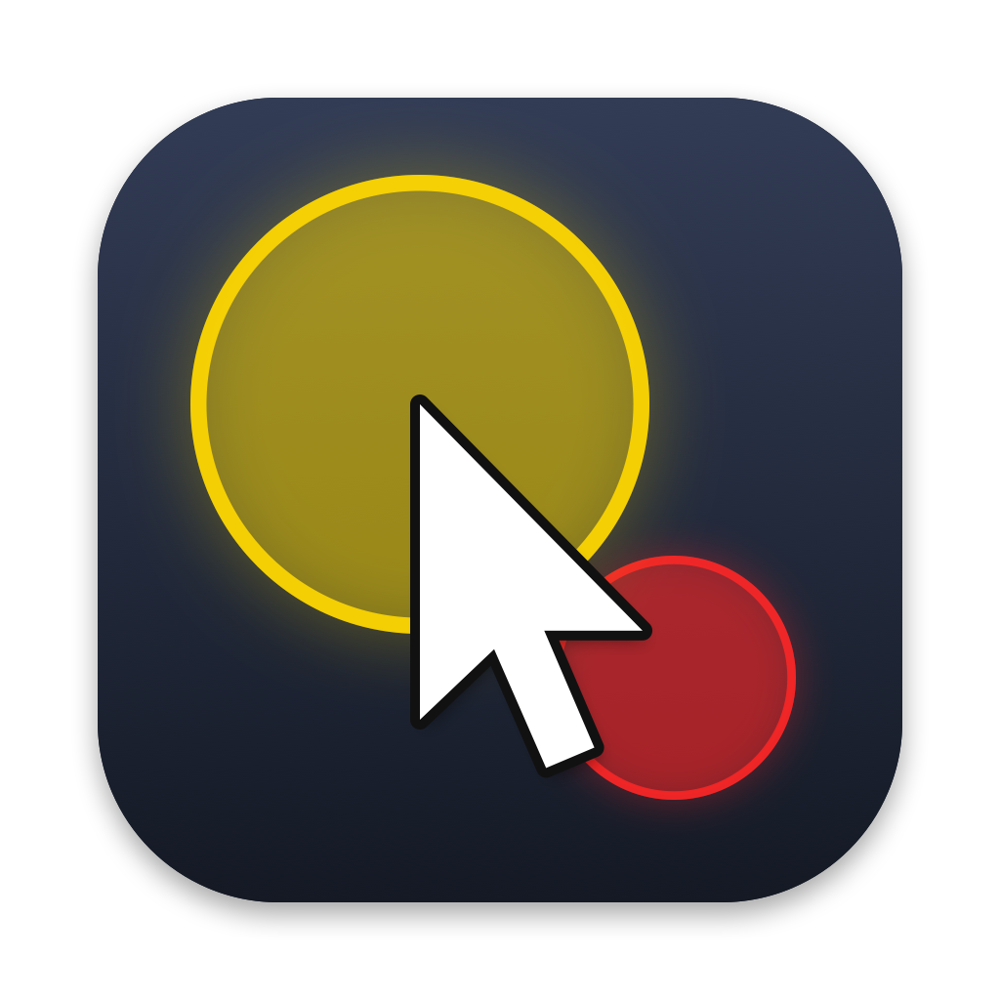
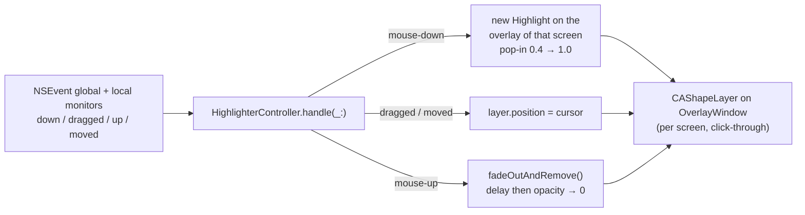

<div align="center">


# Mouse Highlighter

**A tiny macOS menu-bar app that draws a halo around your cursor every time you click — for screen recordings, demos, and live presentations.**

   
</div>

Left click → yellow halo. Right click → red halo. Hold and drag and it follows the cursor; release and it fades out. A macOS counterpart to [PowerToys Mouse Highlighter](https://github.com/microsoft/PowerToys), in one Swift file with no dependencies.

---

## Contents

- [Features](#features)
- [Requirements](#requirements)
- [Build & install](#build--install)
- [Using it](#using-it)
- [Settings](#settings)
- [How it works](#how-it-works)
- [Project layout](#project-layout)
- [Troubleshooting](#troubleshooting)
- [Known limitations](#known-limitations)
- [Privacy](#privacy)
- [License](#license)

> **Note** — the in-app UI (menu and settings window) is currently Chinese only. The [Settings](#settings) table below gives the English equivalent of every label.

## Features

- **Click feedback you can actually see** — a soft glowing ring at the cursor on mouse-down, following the cursor while you drag.
- **Left = yellow, right = red** — the two buttons are distinguishable at a glance; both can be highlighted at the same time.
- **Pop-in and fade-out** — the ring scales 0.4 → 1.0 on press (0.12 s) and fades after release, with a configurable hold time and duration.
- **Every display, every Space** — one transparent, click-through overlay per screen at `screenSaver` window level, joining all Spaces and floating above full-screen apps. Rebuilt automatically when you plug or unplug a monitor.
- **Never steals a click** — overlay windows ignore mouse events and can never become key/main, so your clicks always land on the app underneath.
- **Menu-bar only** — no Dock icon, no window; toggled with **⌃⌥H**.
- **Launch at login** via `SMAppService`, registered once on first run. Highlighting itself switches on at *every* launch — there is no persisted on/off state.
- **No Accessibility or Screen Recording permission** — mouse events are read with `NSEvent` global monitors, the hot key with Carbon `RegisterEventHotKey`.
- **~600 lines of AppKit, zero dependencies** — built by a 50-line `build.sh`, no `.xcodeproj`.

## Requirements

| | |
| --- | --- |
| OS | macOS 13.0 Ventura or later (`SMAppService` requires 13) |
| Toolchain | Xcode or Xcode Command Line Tools (`swiftc`, `iconutil`) |
| Arch | Apple silicon and Intel (native build on whichever host runs `build.sh`) |
| Committed bundle | `build/MouseHighlighter.app` as checked in is **arm64-only** and stamped `minos 27.2` (the author's build host) — it will not launch on older or Intel Macs; run `./build.sh` there instead |

## Build & install

```bash
git clone https://github.com/askguanyu/MouseHighlighter.git
cd MouseHighlighter

./build.sh              # → build/MouseHighlighter.app
./build.sh install      # also copy to /Applications, quit the old instance, launch
```

`build.sh` compiles `Sources/main.swift`, generates `Resources/AppIcon.icns` (via `Tools/make_icon.swift`) if it is missing, writes `Info.plist` (`LSUIElement`, bundle id `local.mousehighlighter`) and ad-hoc code-signs the bundle.

Launch it any time afterwards with `open /Applications/MouseHighlighter.app`. Because the build is ad-hoc signed and not notarized, a downloaded copy may need **right-click → Open** once, or `xattr -dr com.apple.quarantine /Applications/MouseHighlighter.app`.

Install to `/Applications` if you want launch-at-login to keep working: the login item points at the bundle's location, so moving or rebuilding it elsewhere breaks the registration.

## Using it

Everything lives in the menu-bar item (a cursor glyph; it gains rays when active and dims when disabled).

| Menu item | Shortcut | What it does |
| --- | --- | --- |
| 启用高亮 / Enable highlight | **⌃⌥H** | Toggle highlighting on and off |
| 左键：黄色 · 右键：红色 | — | Colour legend (informational, not clickable) |
| 设置… / Settings… | **⌘,** | Open the settings window |
| 开机自动启动 / Launch at login | — | Register/unregister the login item |
| 退出 / Quit | **⌘Q** | Quit the app |

Only **⌃⌥H** is a system-wide hot key (registered through Carbon). **⌘,** and **⌘Q** are menu key equivalents — they work while the menu is open or a window of this app is frontmost, not from another app.

Changes in Settings apply to the next click, so you can tweak a value and click anywhere to preview it. Pressing the same button again immediately fades out its previous ring; the left and right rings are independent.

## Settings

| Control (EN) | Control (UI, 中文) | Range | Default |
| --- | --- | --- | --- |
| Halo radius | 光圈半径 | 8–120 pt | 20 pt |
| Time shown after release | 松开后显示时间 | 0–3 s | 0 s |
| Fade-out duration | 淡出时间 | 0.05–3 s | 0.05 s |
| Left button fill | 左键填充 | any colour + alpha | `#FFD900` @ 20% |
| Left button ring | 左键外圈 | any colour + alpha | `#FFD900` @ 50% |
| Right button fill | 右键填充 | any colour + alpha | `#FF2626` @ 30% |
| Right button ring | 右键外圈 | any colour + alpha | `#FF2626` @ 50% |

- Alpha is editable — tick the opacity slider in the macOS colour panel (it is enabled automatically).
- The outer glow is derived from the ring colour and follows its alpha; a transparent ring means a weaker glow.
- Ring width (2 pt) and pop-in time (0.12 s) are fixed in `Config`.
- **恢复默认 / Reset defaults** restores every value above.
- Values are stored in `UserDefaults` under `local.mousehighlighter`; wipe them with `defaults delete local.mousehighlighter`.

## How it works



- **`OverlayWindow`** — one borderless window per `NSScreen`, cleared background, `ignoresMouseEvents = true`, `level = .screenSaver`, `collectionBehavior = [.canJoinAllSpaces, .stationary, .fullScreenAuxiliary, .ignoresCycle]`.
- **`Highlight`** — a single `CAShapeLayer` (ellipse + fill + 2 pt stroke + shadow) added as a sublayer of the overlay's content layer. It re-parents itself between screens as the cursor crosses displays and sets `contentsScale` to that screen's backing scale factor, so it stays crisp on mixed-DPI setups.
- All animation is Core Animation (`transform.scale`, `opacity`); layer moves during drags are wrapped in `CATransaction.setDisableActions(true)` so the ring never lags behind the cursor.
- **`HotKey`** installs a Carbon event handler for `kVK_ANSI_H` with Control+Option — no Accessibility prompt, unlike `CGEventTap`.
- First launch registers the login item once (remembered by the `loginItemConfigured` flag) and reports `SMAppService.status` in the menu, including the "needs approval" state.

## Project layout

```
MouseHighlighter/
├── Sources/main.swift        # the whole app: config, settings UI, overlays, hot key, menu
├── Tools/make_icon.swift     # draws the app icon → AppIcon.icns + AppIcon-1024.png
├── Resources/                # generated icon assets
├── build.sh                  # swiftc → build/MouseHighlighter.app  (+ `install`)
└── build/                    # checked-in prebuilt bundle; ./build.sh wipes and rebuilds it
```

## Troubleshooting

| Symptom | Fix |
| --- | --- |
| No halo appears | The menu-bar icon is dimmed → highlighting is off. Click it, or press ⌃⌥H. |
| ⌃⌥H does nothing | Another app already owns that combo; toggle from the menu, or quit the conflicting app. |
| Clicks feel normal but nothing is drawn on one display | Rebuild the overlays by toggling off/on; they are also rebuilt on screen-parameter changes. |
| Another overlay app covers the halo | Both sit at `screenSaver` level; z-order between them is undefined. Quit the other overlay. |
| "Launch at login" shows a warning state | Approve the app in **System Settings → General → Login Items**. |
| Login item stops working after a rebuild | Re-run `./build.sh install`, then re-toggle the menu item. |
| "App can't be opened" on first launch | Right-click → Open, or clear the quarantine attribute (see [Build & install](#build--install)). |

## Known limitations

- Left and right buttons only — no middle click, trackpad three-finger drag, or Apple Pencil.
- No ripple/press-count effect on release, unlike PowerToys' click overlay.
- Settings are global: no per-display colour or size, and the hot key is hard-coded to ⌃⌥H.
- UI text is Chinese only.
- The overlay floats above normal windows but can be covered by other screen-saver-level windows (screenshots taken with some capture tools may or may not include the halo, depending on the tool).

## Privacy

No network code, no telemetry, no files written outside `UserDefaults`. Mouse events are observed in memory and used only to position the ring.

## License

MIT © [askguanyu](https://github.com/askguanyu) — see [LICENSE](LICENSE).

---

<div align="center">


# Mouse Highlighter（中文）

**一个极小的 macOS 菜单栏工具：每次点击鼠标时在光标处画出光圈 —— 适用于录屏、演示和直播分享。**

</div>

左键 → 黄色光圈，右键 → 红色光圈。按住拖动时光圈跟随光标，松开后延时淡出。对应 Windows 上 [PowerToys Mouse Highlighter](https://github.com/microsoft/PowerToys) 的 macOS 版本：单个 Swift 文件，零依赖。

## 功能特性

- **看得见的点击反馈** —— 按下鼠标时光标处出现柔光圆环，拖动时跟随光标。
- **左键黄色、右键红色** —— 一眼可辨；左键与右键的光圈可同时存在。
- **弹入与淡出** —— 按下时 0.4 → 1.0 缩放（0.12 秒），松开后按可配置的停留时间与淡出时长消失。
- **覆盖所有屏幕与所有桌面** —— 每个屏幕一个透明、点击穿透的窗口，层级为 `screenSaver`，可加入全部桌面并浮在全屏应用之上；插拔显示器后自动重建。
- **绝不抢点击** —— 覆盖窗口忽略鼠标事件，也不能成为 key/main 窗口，点击始终落在下层应用。
- **仅菜单栏** —— 没有 Dock 图标和主窗口，**⌃⌥H** 一键开关。
- **开机自启** —— 基于 `SMAppService`，首次启动注册一次。高亮开关不做持久化：**每次**启动都会自动开启。
- **无需辅助功能 / 录屏权限** —— 鼠标事件用 `NSEvent` 全局监听，快捷键用 Carbon `RegisterEventHotKey`。
- **约 600 行 AppKit，零依赖** —— 由 50 行的 `build.sh` 构建，没有 `.xcodeproj`。

## 环境要求

| | |
| --- | --- |
| 系统 | macOS 13.0 Ventura 及以上（`SMAppService` 要求 13+） |
| 工具链 | Xcode 或 Xcode Command Line Tools（`swiftc`、`iconutil`） |
| 架构 | Apple 芯片与 Intel（在宿主机上原生编译） |
| 已提交的 App | 仓库里的 `build/MouseHighlighter.app` 仅 arm64、且 `minos` 为 27.2（作者构建机），在更旧或 Intel 的 Mac 上无法启动；请到本机执行 `./build.sh` 重新构建 |

## 构建与安装

```bash
git clone https://github.com/askguanyu/MouseHighlighter.git
cd MouseHighlighter

./build.sh              # 产出 build/MouseHighlighter.app
./build.sh install      # 同时安装到 /Applications，退出旧进程并启动
```

`build.sh` 编译 `Sources/main.swift`，若缺少 `Resources/AppIcon.icns` 则用 `Tools/make_icon.swift` 生成，写入 `Info.plist`（`LSUIElement`，Bundle ID `local.mousehighlighter`），最后做 ad-hoc 签名。

之后用 `open /Applications/MouseHighlighter.app` 启动即可。由于是 ad-hoc 签名且未做公证，下载来的副本首次可能需要**右键 → 打开**，或执行 `xattr -dr com.apple.quarantine /Applications/MouseHighlighter.app`。

希望开机自启持续生效就装到 `/Applications`：登录项记录的是 App 所在位置，把 App 移走或换目录重建都会让注册失效。

## 使用方法

全部功能都在菜单栏图标里（光标图形：开启时带光芒，关闭时变灰）。

| 菜单项 | 快捷键 | 说明 |
| --- | --- | --- |
| 启用高亮 | **⌃⌥H** | 开关高亮功能 |
| 左键：黄色 · 右键：红色 | — | 颜色说明（不可点击） |
| 设置… | **⌘,** | 打开设置窗口 |
| 开机自动启动 | — | 注册 / 取消登录项 |
| 退出 | **⌘Q** | 退出程序 |

只有 **⌃⌥H** 是全局快捷键（通过 Carbon 注册）。**⌘,** 与 **⌘Q** 是菜单键，仅在菜单打开或本 App 的窗口处于前台时有效，在其他 App 中按无效。

设置修改后对下一次点击立即生效，可以边调边点鼠标预览。重复按同一个键会立即淡出该键上一个光圈；左键与右键的光圈互相独立。

## 设置项

| 控件 | 范围 | 默认值 |
| --- | --- | --- |
| 光圈半径 | 8–120 pt | 20 pt |
| 松开后显示时间 | 0–3 秒 | 0 秒 |
| 淡出时间 | 0.05–3 秒 | 0.05 秒 |
| 左键填充 | 任意颜色 + 不透明度 | `#FFD900` 20% |
| 左键外圈 | 任意颜色 + 不透明度 | `#FFD900` 50% |
| 右键填充 | 任意颜色 + 不透明度 | `#FF2626` 30% |
| 右键外圈 | 任意颜色 + 不透明度 | `#FF2626` 50% |

- 不透明度可调：程序会自动在系统颜色面板中打开 Alpha 滑块。
- 外发光由外圈颜色决定，外圈越透明发光越弱。
- 外圈线宽（2 pt）与弹入时长（0.12 秒）固定在 `Config` 中。
- **恢复默认** 一键还原以上全部取值。
- 设置保存在 `UserDefaults`（域名 `local.mousehighlighter`），可用 `defaults delete local.mousehighlighter` 清空。

## 实现原理

- **`OverlayWindow`**：每个 `NSScreen` 一个无边框窗口，背景透明、`ignoresMouseEvents = true`、`level = .screenSaver`、`collectionBehavior = [.canJoinAllSpaces, .stationary, .fullScreenAuxiliary, .ignoresCycle]`。
- **`Highlight`**：一个 `CAShapeLayer`（椭圆 + 填充 + 2 pt 描边 + 阴影），作为覆盖层 content layer 的子层。光标跨屏时自动在屏幕之间重新挂载，并按该屏 `backingScaleFactor` 设置 `contentsScale`，混合 DPI 下依然清晰。
- 动画全部交给 Core Animation（`transform.scale`、`opacity`）；拖动时移动图层用 `CATransaction.setDisableActions(true)` 关闭隐式动画，光圈不会落后于光标。
- **`HotKey`**：用 Carbon 事件处理器监听 Control+Option+H，相比 `CGEventTap` 不需要辅助功能授权。
- 首次启动会注册一次登录项（由 `loginItemConfigured` 标记控制），并在菜单中反映 `SMAppService.status`，包括「需在系统设置中允许」状态。

## 目录结构

```
MouseHighlighter/
├── Sources/main.swift        # 完整程序：配置、设置界面、覆盖窗口、快捷键、菜单栏
├── Tools/make_icon.swift     # 绘制 App 图标 → AppIcon.icns + AppIcon-1024.png
├── Resources/                # 生成的图标资源
├── build.sh                  # swiftc → build/MouseHighlighter.app（+ `install`）
└── build/                    # 随仓库附带的预构建 App；./build.sh 会删除后重建
```

## 常见问题

| 现象 | 处理 |
| --- | --- |
| 点击没有光圈 | 菜单栏图标变灰说明功能已关闭；点图标或按 ⌃⌥H 开启 |
| ⌃⌥H 无反应 | 该组合键被其他应用占用；改用菜单开关，或退出冲突应用 |
| 某个屏幕突然不画了 | 先关再开重建覆盖层；插拔显示器时也会自动重建 |
| 光圈被别的悬浮工具盖住 | 双方同为 `screenSaver` 层级，叠放顺序不确定；退出另一个悬浮工具 |
| 「开机自动启动」显示需允许 | 到「系统设置 → 通用 → 登录项」中允许本 App |
| 重新构建后自启失效 | 再次执行 `./build.sh install`，然后在菜单里重新开关一次 |
| 首次打开提示无法打开 | 右键 → 打开，或按上文清除 quarantine 属性 |

## 已知限制

- 仅支持左键与右键：不含中键、触控板三指拖移、Apple Pencil。
- 没有松开时的涟漪 / 连击次数提示（PowerToys 的点击效果）。
- 设置为全局生效：不支持按显示器分别配色配尺寸；快捷键固定为 ⌃⌥H，暂不可改。
- 界面文案目前仅有中文。
- 覆盖层浮于普通窗口之上，但可能被其他 `screenSaver` 层级窗口遮挡；部分截图工具是否录到光圈取决于工具本身的抓取层级。

## 隐私

无网络请求、无统计上报、除 `UserDefaults` 外不写任何文件。鼠标事件只在内存中用于定位光圈。

## 许可证

MIT © [askguanyu](https://github.com/askguanyu)，详见 [LICENSE](LICENSE)。
